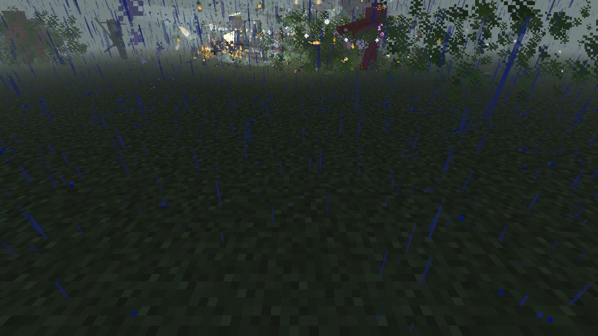
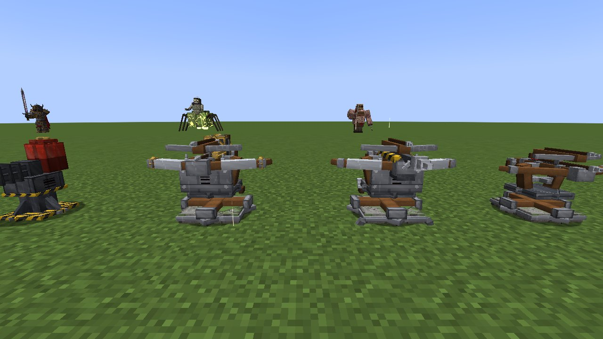
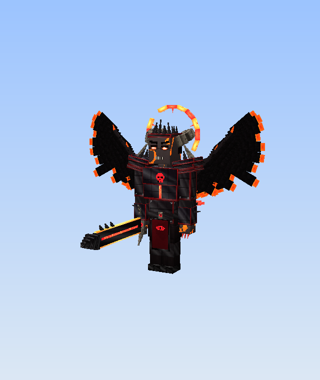
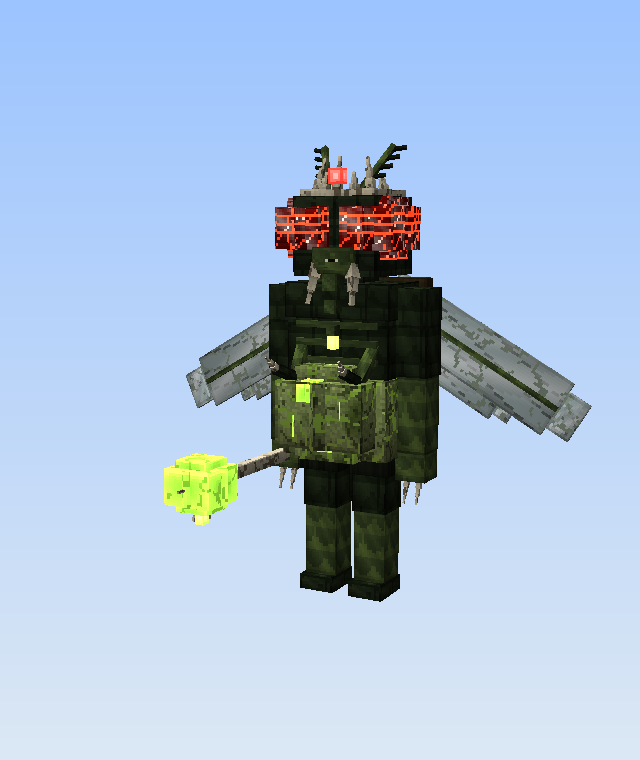
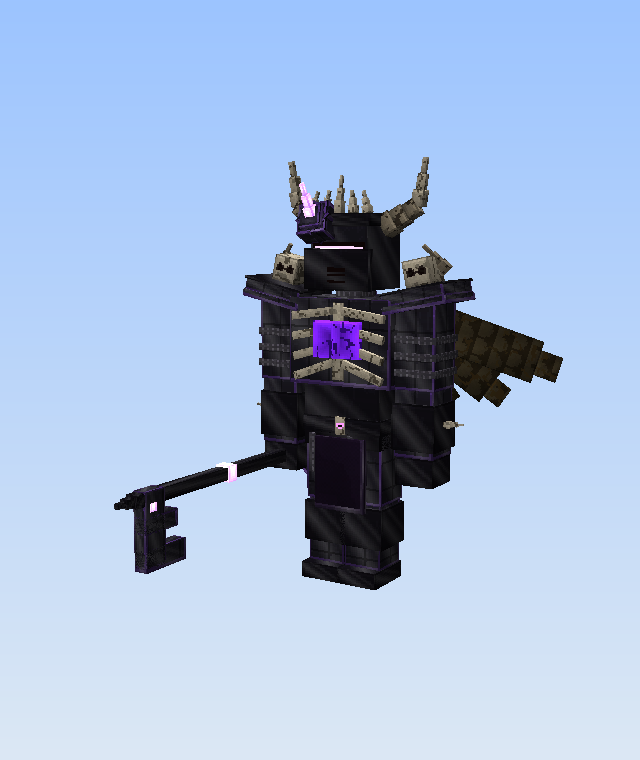
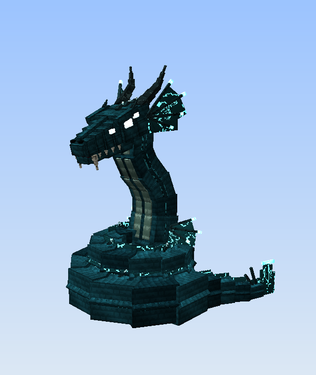
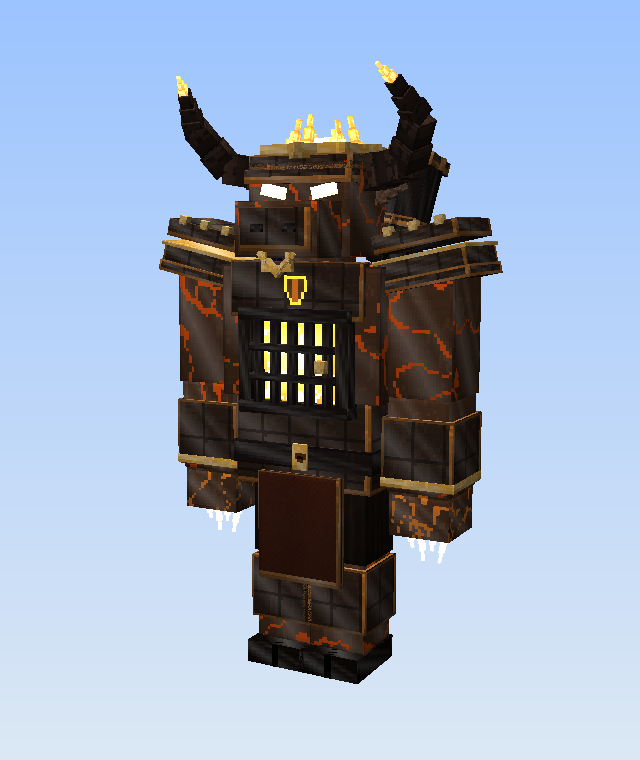
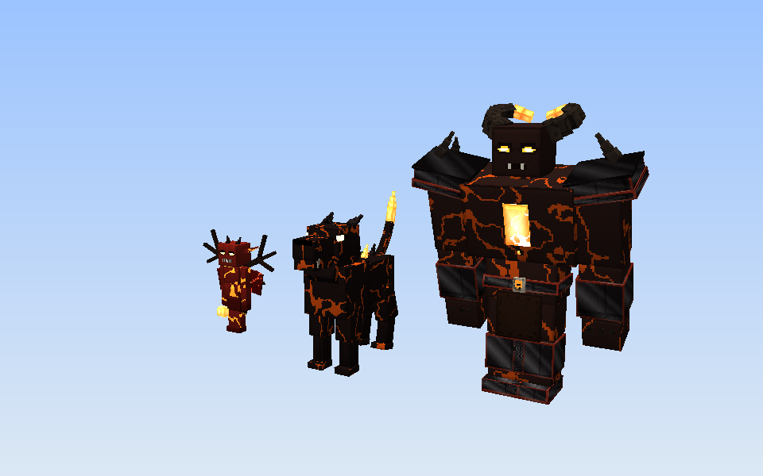

# Last Bastion: Zombie Siege

A Forge mod for **Minecraft 1.20.1** (Forge 47.x). Craft a Siege Core, place it, and hold it against a zombie siege
that comes every night from every direction and gets harder with each wave. Kills earn credits, which you spend at the
core on turrets, heroes, devils, weapons, armour, call-ins and fortifications. Every part of the siege can be tuned in
game, from enemy health to which zombies and bosses may appear. If the core falls, the siege starts again from wave 1.

## Screenshots
The CI showcase job (`[showcase]` commits) launches the real client headless and photographs every model into
`docs/screenshots/`:

| | |
|---|---|
|  |  |
|  |  |
|  |  |
|  |  |

The Devils and their hellspawn, rendered offline from the same model code (rest pose):

| Lucifer | Beelzebub | Abaddon | Leviathan | Moloch |
|---|---|---|---|---|
|  |  |  |  |  |



## Installing
1. Install **Forge 1.20.1** (47.3.0 or newer).
2. Build the jar with `./gradlew build` (or grab `lastbastion-jar` from the latest GitHub Actions run). The jar is
   `build/libs/lastbastion-1.20.1-1.0.0.jar`.
3. Put it in your `.minecraft/mods` folder. It is needed on both the server and the client.

## Getting started
1. Craft a **Siege Core**:
   ```
   [Iron Block] [Gold Ingot] [Iron Block]
   [ Redstone ] [ Diamond  ] [ Redstone ]
   [Iron Block] [Gold Ingot] [Iron Block]
   ```
2. Place it. Only one core can exist per world. Right-click it to open the **War Room**.
3. Use the daytime to build. Wave 1 starts at nightfall (or on a timer, or only when you sound the War Horn, see
   *Siege rules*). Sounding the **War Horn** early pays +25%.
4. Every player starts with **400 credits**. Kills pay whoever landed the blow; kills by turrets, heroes and devils pay
   their owner. Each cleared wave pays `50 + 20 × wave` to every defender, and a wave where the core is never touched
   pays a perfect-defence bonus.

The HUD shows the wave, core health and barrier, enemies remaining or the time to the next wave, your credits, the
next wave's intel (night type, enemy count, bosses) and arrows to live objectives such as supply drops and rifts.

## The siege
* Zombies rise out of the ground in a ring around the core (44 blocks by default). Wave 1 comes from one side; by wave
  15 they come from all directions with flanking groups.
* Zombies march on the core and **breach anything in their way**, with cracking animations. They turn to fight
  defenders who get close or hurt them, but a leash pulls them back to the core.
* The siege only runs while a player is within 160 blocks of the core.
* **Defeat:** when the core reaches 0 HP it explodes. By default you keep 25% of your credits, turrets are lost, and
  your heroes' and devils' sigils return to you recovering. The siege resets to wave 1 and a new core drops.
* **Victory:** set a victory wave in the rules and holding it ends the siege in triumph.
* Every 10th wave and every boss pays out **Warforged Tokens**, the currency for the best upgrades.

### Siege rules
Open **Siege Rules** from the War Room (or `/siege rules`). Every setting is per world, saved with it, and announced to
everyone when changed. Presets (Casual, Normal, Veteran, Nightmare) fill the difficulty block; tweak anything and it
becomes Custom.

| Section | Settings |
|---|---|
| Difficulty | preset, enemy health, enemy damage, wave size, growth per wave, boss health, champion rate, core health |
| Pacing | what starts a wave (nightfall, a timer, or only the War Horn), preparation time, boss every N waves, victory wave, max enemies alive, spawn distance, wave time limit |
| Twists | special nights on/off, their chance and first wave, each night type individually, war events on/off, their rate and first wave, supply drops, corruption rifts, warlords |
| Roster | every zombie type and every boss on or off, and whether zombies break blocks |
| Stakes | credit multiplier, downed state, bleed-out time, harsh defeat, salvage %, perfect-defence bonus % |

Who may edit the rules is a server setting (core owner or operators by default).

### War events
From mid-game, waves are interrupted by events, marked on the HUD with an arrow and distance:
* **Supply Drop**: a crate parachutes in. Reach it before it scuttles itself for credits, ammunition, grenades,
  call-ins, consumables and sometimes tokens.
* **Warlord**: a named, oversized champion with a boss bar and an escort, rallying the zombies around it. Kill it for
  four times the credits and a token.
* **Corruption Rift**: a tear in the world that keeps spewing zombies at the core until it is destroyed. It blasts back
  anyone who loiters at it.

### Co-op: downed, not dead
With other players defending, a lethal blow knocks you **down** instead: you crawl, can't fight, and bleed out after 30
seconds (adjustable in the rules). A teammate who crouches next to you for three seconds revives you (and is paid for it). Clearing the wave
gets everyone back up. If the whole party is down, bleeding out speeds up.

### Difficulty model (Normal)
| Mechanic | Scaling |
|---|---|
| Threat budget | `18 × 1.12^(w-1) + 8(w-1)`, × difficulty, × (1 + 0.5 per extra player) |
| Enemy HP / damage | +7% / +3.5% per wave |
| Zombie rank | centre rank = (w-1)/7: Rotten → Feral → Armored → Corrupted → Abyssal |
| Champions | from wave 4: 2% + 0.5%/wave (max 15%), with 1–3 affixes |
| Spawn fronts | 1 → 2 → 3 → 4 → all round with flankers |
| Bosses | every 5th wave, cycling through all 6. After wave 30 several come at once |
| Special nights | from wave 6, 35% chance: Blood Moon, Graveyard Fog, Thunderstorm, Horde Night, Elite Vanguard, Necrotic Tide (each pays bonus credits) |

## Enemies
**15 zombie types × 5 ranks.** Higher ranks are tougher and look different: rusted helmets and pauldrons, glowing void
crystals, and finally horns, burning eyes and a hellfire crown.

| Zombie | Role |
|---|---|
| Shambler | Slow, endless foot soldier |
| Runner | Sprints and pounces |
| Spitter | Corrosive bile from range, prefers turrets |
| Brute | Tank with a charge; breaches walls 3× faster and smashes turrets |
| Bloater | Swells and explodes into a toxic cloud. Kill it far from your walls |
| Leaper | Vaults over walls |
| Bulwark | Tower shield blocks 80% of frontal projectiles |
| Burrower | Tunnels under walls and erupts beside the core |
| Shrieker | Screams to enrage zombies and jam turrets |
| Wraith | Phases through walls; resists physical, weak to holy and arcane |
| Wrecker | Hunts turrets with a siege hammer (3× damage to turrets) |
| Necromancer | Raises shamblers and heals the horde |
| Crawler | A legless torso that clings to ankles and slows you to a crawl |
| Incinerator | Hoses turrets and defenders with fire; its tanks explode when it dies, burning the horde too |
| Abomination | Elite stitched giant that hurls crawlers, slams crowds and smashes walls and turrets |

**Champion affixes:** Vampiric, Molten, Frostbound, Shielded, Hasted, Splitting, Blinking, Reflective, Warded, Juggernaut.

**Bosses** (each has a boss bar, phases and its own moveset):
* **Gorehound the Butcher**: cleaver combo, meat-hook pull, rampage charge, Blood Frenzy at 50%.
* **The Plague Mother**: toxic spew, brood birth, acid rain, crushing leap in phase 2.
* **Malgrave the Dread Knight**: greatsword combo, shadow charge, dark wave, death knights, Soulfire Ascension.
* **The Ossuary Colossus**: boulder throws at turrets, quake stomp, bone spikes, core smash, ribcage breach.
* **Varkhul the Lich King**: soul volleys, frost nova, death coil; phylactery crystals keep him invulnerable until
  destroyed; raises an army of the dead.
* **Morvathrax the Rotwing**: undead dragon. Strafes, dives and rains bone, then crashes down at 40% and fights on foot.

## Turrets (10 types, levels 1–5)
Each level raises damage, range, fire rate and hull and changes the model. Level 3 adds a perk; at level 5 you choose
one of two specialisations, each with its own model. Turrets can be repaired, sold (60% refund) and switched between
targeting modes (closest to core, nearest, strongest, weakest).

| Turret | Effect | Level 3 | Level 5 (choose one) |
|---|---|---|---|
| Ballista | Bleeding | Twin Bolts | Siegebreaker / Repeater Scorpion |
| Inferno Turret | Burn, Scorched | Napalm | Soulfire Maw / Napalm Launcher |
| Cryo Spire | Chill → Frozen | Splinter | Absolute Zero / Glacial Lance |
| Tidecaller | Soaked (+50% lightning damage taken) | Breaker Wave | Maelstrom / Leviathan's Wrath |
| Tesla Coil | Shocked, chains | Arc Amplifier | Stormcaller / Arc Reactor |
| Venom Lobber | Corroded (armour shred) | Caustic Flood | Plague Cauldron / Blightspore Hive |
| Siege Mortar | Concussed | Cluster Shells | Bombardment Battery / Grand Cannon |
| Arcane Prism | Marked, ramping beam | Refraction | Annihilation Lance / Kaleidoscope |
| Gale Tower | Disoriented, knockback | Tornado | Cyclone Wall / Tempest Eye |
| Sanctum Obelisk | Purified; heals allies and the core | Blessing | Divine Judgement / Seraph's Sanctuary |

Elements combine: Soaked targets take extra lightning damage and chain further; Frozen targets shatter for +50%
physical or explosive damage.

## Heroes and Devils
Summon a hero with its **Sigil**, or bind a devil with its **Infernal Pact**, anywhere: no core needed. Near a core they
guard it; anywhere else they follow you. **Sneak + right-click** a summon to cycle its orders, right-click it for its
command screen, or press **G** to order all of them at once (including *Recall all to me*).
* **Guard**: holds the core (or the spot where you left it) and attacks whatever comes closest.
* **Hunt**: roams and goes after bosses, champions, necromancers and shriekers first.
* **Follow Me**: stays at your side, attacks whatever you hit and whatever hits you, and follows you through portals.

Summons level up from kills (Lv1–5, stronger stats and extra gear on the model) and keep their level in the sigil.
When one falls, its sigil comes back to you **recovering** (about a minute for Ashfang, five for Zeus, ten for a
devil); you can rush the recovery at the core. You can command up to 6 heroes at once (configurable).

| Hero | Cost | Moveset |
|---|---|---|
| Ashfang the Dire Wolf | 350 | Rending bites, pounce, hamstring, Howl of the Pack, ULT Alpha's Hunt |
| Sylva the Huntress | 600 | Aimed shot, piercing arrow, arrow rain, snare trap, evasive roll, hunter's mark, ULT Wild Hunt |
| Bastion, the Stone Colossus | 900 | Granite fists, taunt, earthshatter, boulder toss, stoneskin, ULT Mountain's Wrath |
| Sir Aldric, Knight of Dawn | 1300 | Dawn combo, shield bash, radiant dash, consecration, Aegis of Dawn, ULT Dawnbreak |
| Morgana the Stormweaver | 1800 | Arcane bolts, chain lightning, frost nova, gravity well, blink, meteor, ULT Tempest |
| Kage the Ronin | 2600 | Four-cut combo, iaido flash, parry and riposte, smoke step, shadow clones, ULT Thousand Cuts |
| AEGIS-7 War Mech | 3600 | Twin miniguns, missile swarm, seismic stomp, repulsor shield, overdrive, ULT Orbital Lance |
| Asterion, the Minotaur King | 5000 | Labrys cleaves, gore, bull rush, war stomp, earthsplitter, bloodrage, ULT King of the Labyrinth |
| Anubis, Judge of the Dead | 7000 | Sceptre strikes, sand bolts, Weighing of Hearts (execute), sandstorm, soul siphon, curse, ULT Hall of Judgement |
| Zeus, King of Olympus | 10000 | Thunderbolt javelins, thunderclap, chain storm, Olympian Smite, Aegis of Olympus, ULT Wrath of the Sky |

### The Devils
Five demons of scripture, far beyond any hero: thousands of health, infernal damage that ignores armour, immunity to
fire and every harmful effect, and they never retreat. Each player can be bound to **one** devil at a time, the pact
costs half your current health (never lethal), and a fallen devil needs ten minutes to claw its way back. They arrive
through a summoning circle of hellfire and sink back into the abyss when they fall.

| Devil | Cost | Moveset |
|---|---|---|
| **Lucifer, King of Hell** | 45000 | Perdition combo and Rend (a fissure of hellfire), The Fall (soars and crashes down like a burning star), Damnation (brands a crowd, drags the broken into the pit), Chains of Hell, Wings of Perdition, Dread Sovereign (fear and a frenzy for allies), Legions of Hell (imps, hellhounds and a fiend). **ULT Hell on Earth**: he ascends, hellfire meteors rain, and he falls back in a black nova that executes the broken |
| **Beelzebub, Lord of the Flies** | 36000 | Swarm bolts, a hunting Plague Swarm, Gluttony (devours an enemy whole and grows stronger), Pestilent Rain, Brood of Flies, Lord of Decay (rots the horde, heals allies), Bile Torrent. **ULT Feast of a Thousand Flies**: he dissolves into an untouchable storm of flies that sweeps through the horde |
| **Abaddon, the Destroyer** | 40000 | The Key of the Abyss as a mace, Abyss Gate, Chains of the Pit, Scorpion's Torment, Locust Plague, Destroyer's Challenge (the whole horde turns on him while he shrugs it off), Shattering the Seal. **ULT The Bottomless Pit**: the ground opens and chains drag the horde into the dark |
| **Leviathan, Serpent of the Abyss** | 48000 | Abyssal bite and tail lash, Black Tide, Maelstrom, Crushing Coils (holds even a boss and hurls it), Abyssal Breath, The Deep Boils, Abyssal Dive (burrows and erupts under the horde). Soaked enemies take 40% more from him. **ULT The Deep Rises**: the abyss floods the field, lifts everything and slams it down |
| **Moloch, the Furnace King** | 38000 | Burning blows, Brazen Charge, Furnace Maw (the door in his belly swings open), The Offering (feeds an enemy to his furnace), Molten Rain, Pillars of Tophet, Brazen Brand (branded enemies explode when they die). Burning kills stoke his furnace; at full heat he turns **molten**. **ULT The Valley of Tophet**: a lake of fire where pillars take offerings one by one |

Lucifer's Legions summon three kinds of **hellspawn**: cackling imps that throw hellfire, hellhounds that bite and
breathe fire, and hulking fiends that slam crowds. They fight for the devil's summoner and burn away after a while.

## Arsenal and Armoury
* **Melee weapons** (combos, finishers, a special on right-click, Mk upgrades bought with Warforged Tokens): Militia
  Longsword (riposte), Frostfang (shadow step), Bonecleaver (whirlwind), Voidedge (phase rend), Stormpiercer (thunder
  javelin), Earthshaker (tectonic leap), Dawnbreaker, Soulreaper.
* **Guns** (3D models, magazines and reloads, alt-fire, recoil): M60 "Ravager" machine gun, "Thunderboom" scattergun,
  "Hellfire" rocket launcher, "Starpiercer" railgun, "Dragon's Breath" flamethrower, "Stormfist" tesla gauntlet,
  "Glacier" cryo cannon, "Sunlance" holy repeater.
* **Armour sets** (3D worn models, full-set bonuses): Scavenger Rig (more credits, speed), Shadowstalker Leathers
  (evasion, crits), Arcanist Regalia (faster specials and reloads, arcane nova), Vanguard Plate (damage reduction,
  emergency barrier), Sunforged Paladin (burns undead, kills heal), Titan Exo-Frame (jump jets, slam landings).
* **Grenades:** frag, incendiary, cryo, holy, singularity.
* **Call-ins:** Orbital Strike remote, Airstrike flare, Sentry Drone, and the **Titan Exosuit Beacon**: a drop pod
  unfolds into a power suit with rotary cannons, homing missiles and jump jets that absorbs all damage aimed at you.
* **Supplies:** bandages, medkits, berserker stims, core repair kits, golden apples, totems, arrows.

## The War Room
Tabs for **Turrets, Heroes, Devils, Arsenal, Armory, Support, Supplies, Fortify and Core**, plus a command tab with the
rules, protocols, your summons and the next wave's intel.
* **Fortify:** wooden, stone, iron and runic barricades (reinforced tiers drop a tier when breached; runic wards zap
  attackers), spike traps, landmines, Medic Shrine, Soul Harvester (+25% credits nearby), Repair Pylon.
* **Core upgrades:** Fortified Core, Arcane Barrier, Retaliation Pulse, War Treasury, Turret Overclock, Rally Beacon,
  and emergency core repair.

## Commands
`/siege status` · `/siege start` · `/siege setwave <n>` · `/siege credits <player> <amount>` ·
`/siege spawn <zombie> [rank 1-5] [champion]` · `/siege boss <boss>` · `/siege event <supply_drop|warlord|rift>` ·
`/siege rules [list|set <rule> <value>|preset <name>|reset]` · `/siege defeat`
(starting, spawning, credits, events, defeat and changing rules from the command line need operator permission;
`status` and viewing the rules are open to everyone).

## Configuration
`config/lastbastion-common.toml`:
* **economy**: starting credits, credit multiplier, shared team wallet.
* **siege**: defaults for new sieges (difficulty, spawn radius, block breaking and the hardness cap, harsh defeat,
  salvage fraction, base core health, max alive enemies, special nights, war events), build radius, player presence
  radius, and who may edit the in-game rules (owner or op, ops only, anyone, locked).
* **coop**: downed state on/off and bleed-out time.
* **summons**: summon anywhere (or only near a core), heroes per player, the devils' blood price.

## Building
```
./gradlew build               # jar in build/libs/
./gradlew runClient           # dev client
./gradlew runGameTestServer   # server smoke tests: turrets, heroes, devils, zombies, bosses, raids, rules, co-op, pacts
```
`tools/gen_*.py` regenerate item textures, models and the lang file. Entity models and their textures are built in code:
`client/model/` defines each model with a small modelling DSL and paints its texture procedurally when the game starts,
so geometry and textures always match.
