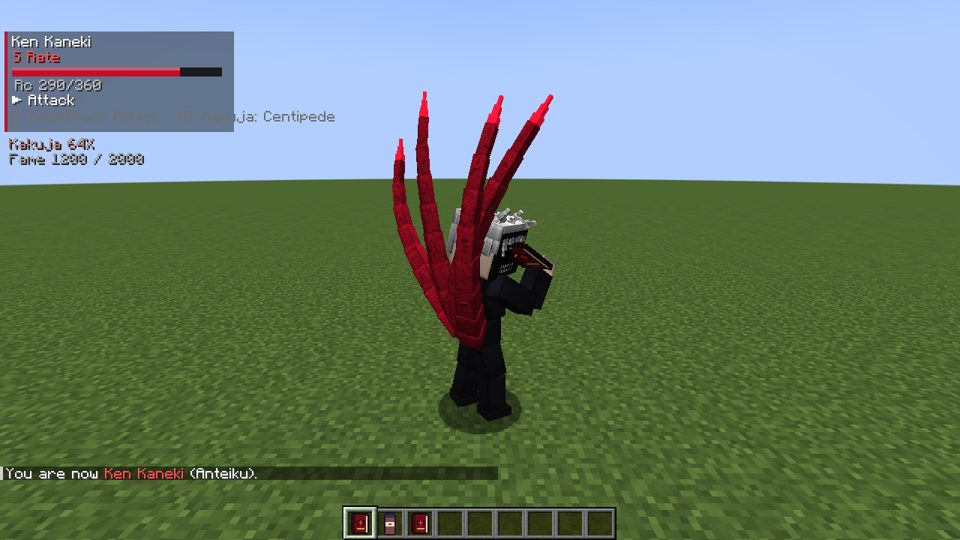
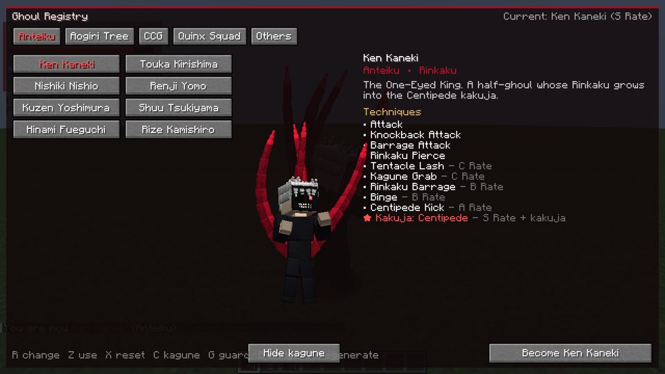
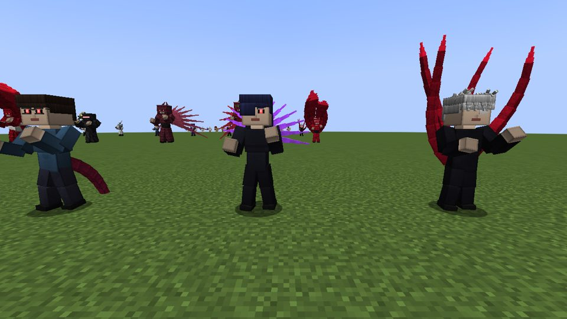
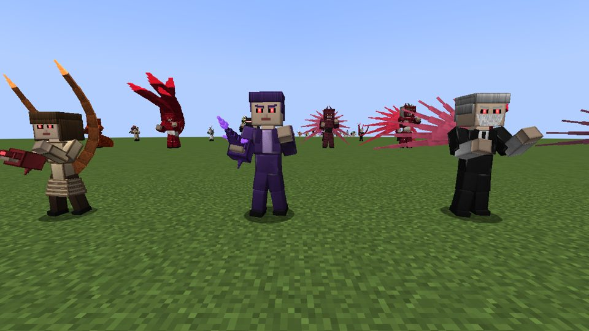
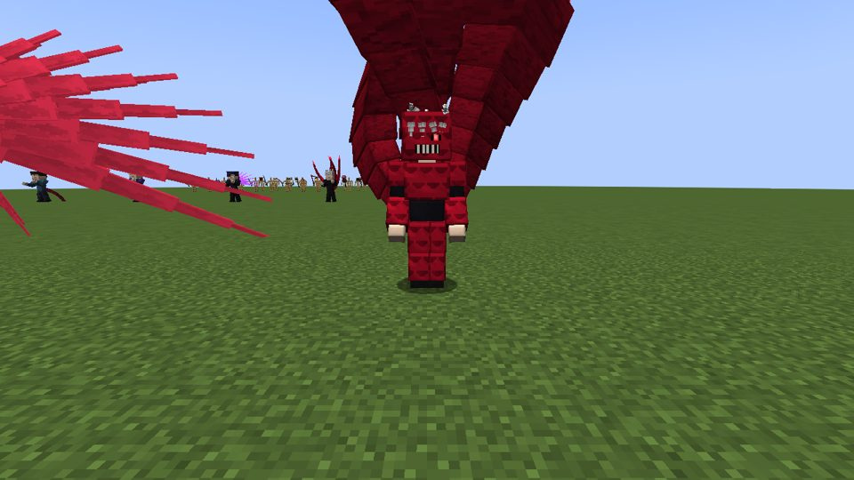
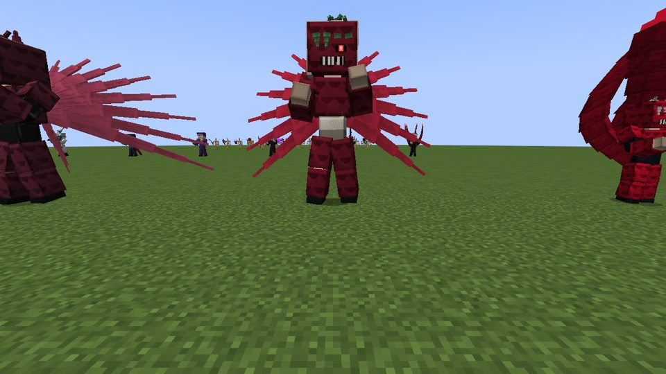
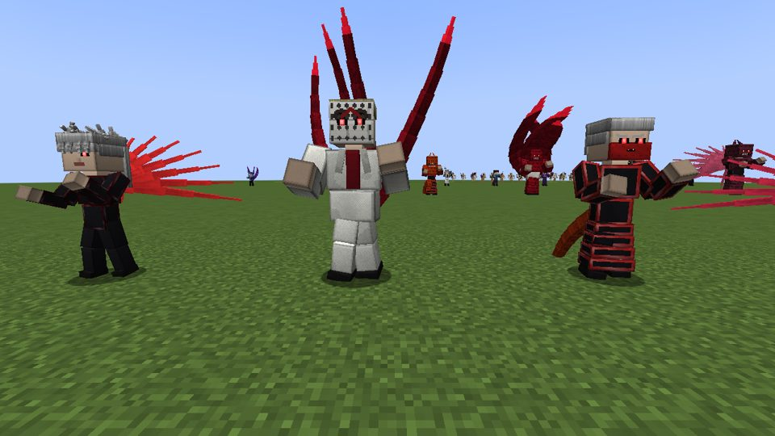
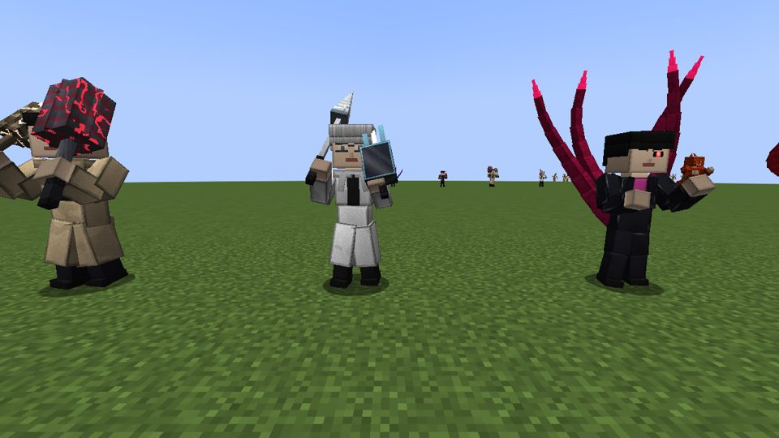
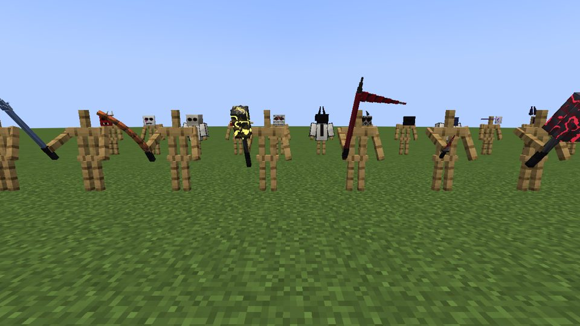
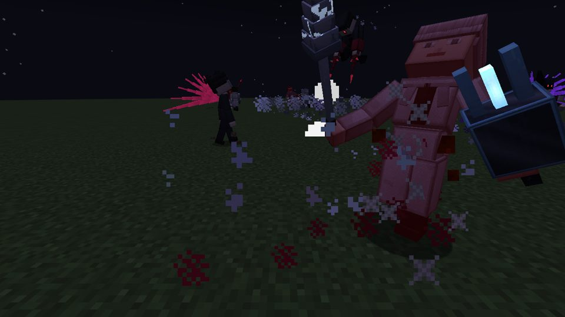

# Tokyo Ghoul Craft

A Forge mod for **Minecraft 1.20.1** (Forge 47.x). Become any major character from *Tokyo Ghoul* and
*Tokyo Ghoul:re*, fight with their canon kagune or quinques, climb the ghoul ratings or the CCG ranks,
awaken your kakuja, and face NPCs that use the same movesets with an anime-style fighting AI.

The structure follows *Jujutsu Craft* (book to pick a character, R/Z technique rotation, fame and ranks
that unlock moves, factions, NPC AI). See [docs/JJK_STUDY.md](docs/JJK_STUDY.md) for how each system was
studied and rebuilt. All code here is original.

## Screenshots

Taken by the headless client showcase (`TG_SHOWCASE=1 ./gradlew runClient`, or CI with `[tg-showcase]`).

| | |
|---|---|
|  |  |
|  |  |
|  |  |
|  |  |
|  |  |

## Getting started

On first join you get the **Ghoul Registry** (book) and an **Anteiku Thermos** (right-click: never go
hungry). Open the Registry to choose who you are:

| Group | Characters |
|---|---|
| Anteiku | Ken Kaneki, Touka Kirishima, Nishiki Nishio, Renji Yomo, Kuzen Yoshimura, Shuu Tsukiyama, Hinami Fueguchi, Rize Kamishiro |
| Aogiri Tree | Ayato Kirishima, Eto Yoshimura (One-Eyed Owl), Tatara, Yamori (Jason), Seidou Takizawa, Kurona Yasuhisa, Noro, Nimura Furuta |
| CCG | Kishou Arima, Koutarou Amon, Juuzou Suzuya, Yukinori Shinohara, Kureo Mado, Akira Mado |
| Quinx Squad | Haise Sasaki, Kuki Urie, Saiko Yonebayashi, Ginshi Shirazu, Tooru Mutsuki |
| Others | Ukaku / Koukaku / Rinkaku / Bikaku Ghoul, CCG Investigator, Ordinary Human |

You become the character: your body is drawn as them, with their kagune, mask, kakugan and quinque.

## Controls

| Key | Action |
|---|---|
| **R** / Shift+R | Next / previous technique (locked ones are skipped) |
| **Z** (hold) | Use the selected technique; holding keeps barrages and breath attacks going |
| **X** | Reset to the first technique |
| **C** | Release / retract your kagune |
| **G** (hold) | Guard: blocks most of a frontal hit, costs Rc; Rc at zero breaks your guard |
| **B** | Dodge / backstep with invulnerable frames |
| **M** (hold) | Rc regeneration: trade Rc for health |

Right-clicking a quinque fires its signature technique (IXA's lance, Narukami's lightning…).

## Combat

Every character has the three universal attacks (Attack combo, Knockback Attack, Barrage), their canon
techniques, and an **ultimate**: a kakuja (Centipede, One-Eyed Owl, Owl, Jason's armour…), Arata armour,
White Reaper, or a signature finisher. Moves are built from shared behaviours: strikes, combos, kagune
thrusts, sweeps, shard volleys, storms, dashes, leap slams, grabs, ground spikes, chain lightning, fire
breath, counter stances, devour, blink strikes and transformations.

Hits cause hit-stun that interrupts the victim's move, so trading blows matters. Guarding, dodging,
counter stances and transformations change how hits land. Ghouls shrug off ordinary weapons (half
damage); quinques and kagune cut through.

## Progression

Defeating enemies earns **fame**: `(level + 1)^2 + 1` for the killer and a tenth for allies who fought.
Fame plus the strongest enemy you have beaten decide your **rank**:

* Ghouls: Unrated, C, B, A, S, SS, SSS Rate
* Humans and Quinx: Academy Student, Rank 3, Rank 2, Rank 1, First Class, Associate Special Class, Special Class

Rank raises max Rc, health and damage and unlocks techniques. Ghoul and Quinx ultimates that are a
kakuja also need **kakuja progress**: eat kakuhou (named bosses' are worth more) and devour ghouls.

## Ghoul life

* Ghouls can only digest **human flesh**, **kakuhou**, **Rc cells** and **Anteiku coffee**. Other food
  tastes like clay and gives nothing (game rule `tgGhoulDiet`).
* Ghouls regenerate while fed and with Rc to spare. The **Rc Suppressant** shuts a ghoul's kagune down.
* Masks hide your identity; the CCG coat is the investigators' uniform.

## The world

* **Factions:** the CCG hunts every ghoul. Aogiri Tree hunts humans, investigators and Anteiku. Wild
  ghouls hunt humans. Anteiku only fights back. Your faction is your character's.
* **Encounters** (game rule `tgEncounters`): ghoul raids come for humans and investigators at night, and
  CCG squads come for ghouls. Named characters appear as bosses once the strongest player on the server
  can face them. Bosses show a boss bar and drop their kakuhou.
* NPCs fight with the full anime AI: they pick techniques by range and cooldown, use ultimates when
  desperate, guard or side-step your wind-ups and projectiles, circle-strafe, and fight each other.

## Items

Ghoul Registry, Anteiku Thermos, Anteiku Coffee, Human Flesh, Rc Cells, Rc Suppressant, four kakuhou,
quinques (IXA, Narukami, Yukimura 1/3, Kura, Doujima 1/2, Scorpion 1/56, 13's Jason, Oniyamada,
Fueguchi One, Amatsu, standard and four craftable kagune-type quinques), twelve masks and the CCG coat.
Craft a kagune-type quinque from a kakuhou, an iron ingot and a stick.

## Commands (op)

`/tg character <id> [players]`, `/tg level <1-7>`, `/tg fame <amount>`, `/tg kakuja <0-100>`, `/tg rc`, `/tg reset`

## Game rules

`tgPvp`, `tgFameDifficulty`, `tgEncounters`, `tgGhoulDiet`, `tgStarterKit`

## Building

```
cd tokyoghoul
./gradlew build                 # jar in build/libs
./gradlew runGameTestServer     # every character's moveset, NPC AI, factions, player selection
python3 tools/gen_assets.py     # regenerate icons, lang, recipes
```

The 3D character, kagune, quinque and mask models are procedural (built in code, textures painted at
runtime) using the modelling toolkit from Last Bastion.
